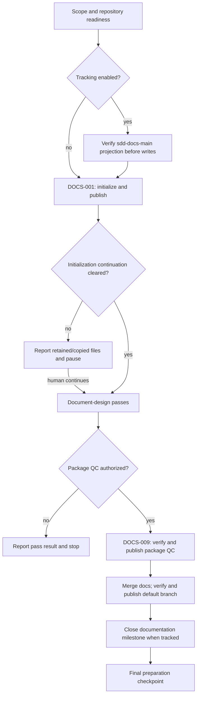
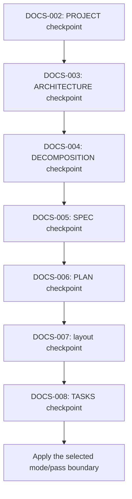
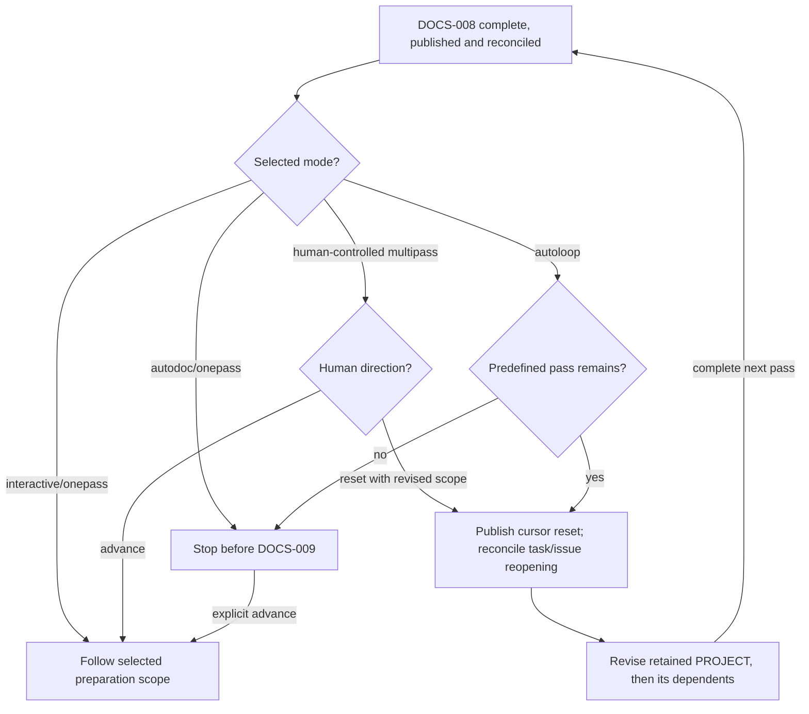
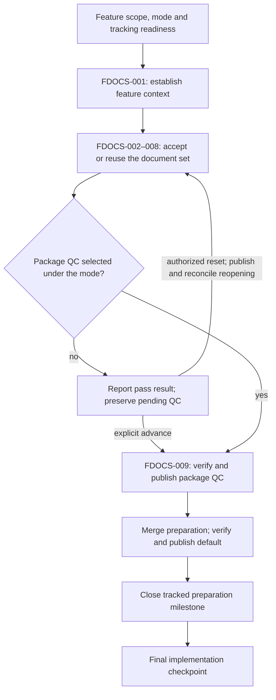
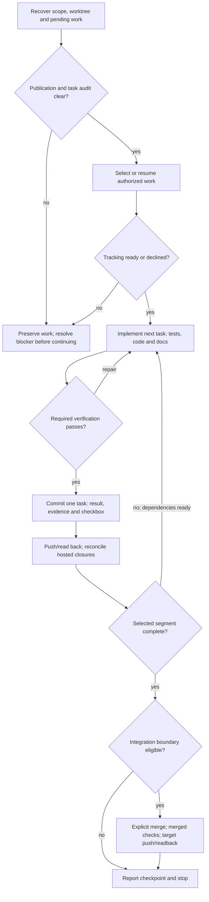
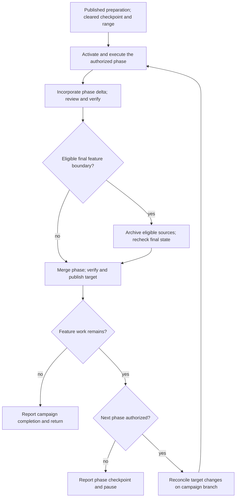
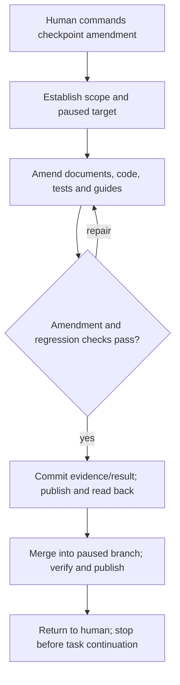
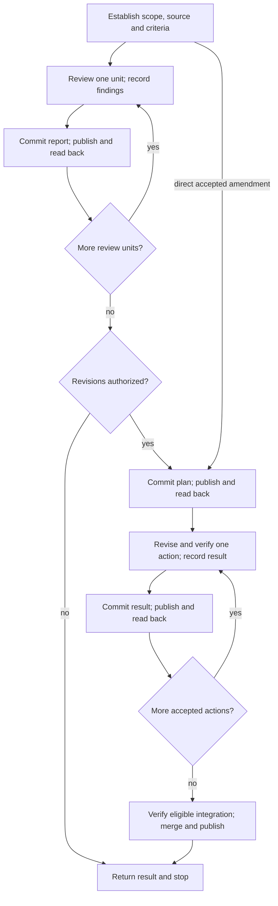

# SDD Manager

**Develop from explicit requirements, implement in bounded steps, and keep the human in control.**

SDD Manager is a learning-by-doing experiment in specification-driven development with coding agents, packaged as an Agent Plugin for Git repositories. It composes focused skills into workflows for exploration, design, specification, planning, implementation, verification and releases. Practical project runs inform its refinement; local source checks and live agent/client acceptance have distinct evidence boundaries.

Navigate: [Quick Start](#quick-start) · [Workflows](#core-development-workflows) · [Modes and checkpoints](#doc-design-modes) · [Continuation](#continue-with-another-agent) · [Workflow diagrams](#workflow-guide) · [Releases](#release-operations) · [Package assets](#plugin-package).

In the source repository, the complete plugin package is at `.agents/plugins/sdd-manager/`, available for agents to load when working on SDD Manager itself. A separate agent installation remains an option. This checkout layout does not configure automatic loading; installed or extracted packages begin at their own plugin root.

The plugin defines a non-standard [PLUGIN.md](PLUGIN.md) entry, analogous to a skill's SKILL.md. PLUGIN.md provides instructions and navigation for the plugin and its skills, just as SKILL.md does for a skill and its references. It also defines common composite workflows involving multiple skills. The **sdd-manage** coordinator skill selects and coordinates these workflows, routing work to the responsible skills.

Development uses [SDD Manager](assets/SDD-MANAGER.md). See the [AI-assisted development disclosure](assets/AI_DISCLOSURE.md).

## Quick Start

Choose the minimal Hello World app, the Tetris game, the calculator, or a template for your own project.

1. Create an initialized GitHub repository from [SDD Manager Template](https://github.com/pchemguy/SDD-Manager-Template).
2. [Create a fine-grained personal access token (PAT)](https://github.com/settings/personal-access-tokens/) restricted to the new repository. A suggested standard set grants **Read and write** permissions for:
    - Actions.
    - Commit statuses.
    - Contents.
    - Issues.
    - Pull requests.
    - Workflows.

    Individual workflows may require fewer permissions; this set is a convenience rather than a universal minimum.

3. Choose a prompt below. Replace `https://github.com/{OWNER}/{REPO}` and `{FINE_GRAINED_GH_TOKEN}` with your repository URL and token, then submit it in a new ChatGPT Work conversation or another agentic environment with SDD Manager available.

### Hello World demo prompts

Both Autodoc prompts display "Hello World" with red/blue/green radio controls. Deliver the browser app, Windows Electron app and Chromium/Firefox extensions in that order; the two extensions form one delivery phase.

| Prompt | Layout scope |
| --- | --- |
| [Autodoc 3in1](https://github.com/pchemguy/SDD-Manager/blob/main/docs/demo/hello_world/prompts/Autodoc%203in1.md) | Browser/Electron panels; extension sidebar controls the message on the active webpage. |
| [Autodoc 3in1 Baseline](https://github.com/pchemguy/SDD-Manager/blob/main/docs/demo/hello_world/prompts/Autodoc%203in1%20Baseline.md) | Simpler shared UI, adapted to fit inside the extension sidebar. |

### Tetris demo prompts

Choose documentation preparation, how to submit the scope, and delivery forms separately. Featured prompts start with Greenfield; submit each later feature section when ready to develop it.

| Prompt | Preparation | Scope submission | Delivery |
| --- | --- | --- | --- |
| [Interactive](https://github.com/pchemguy/SDD-Manager/blob/main/docs/demo/tetris/prompts/Interactive.md) | Interactive | One complete prompt | Browser, then Electron |
| [Autodoc](https://github.com/pchemguy/SDD-Manager/blob/main/docs/demo/tetris/prompts/Autodoc.md) | Autodoc | One complete prompt | Browser, then Electron |
| [Single Page Autodoc](https://github.com/pchemguy/SDD-Manager/blob/main/docs/demo/tetris/prompts/Single%20Page%20Autodoc.md) | Autodoc | One complete prompt | One HTML file |
| [Autodoc 3in1](https://github.com/pchemguy/SDD-Manager/blob/main/docs/demo/tetris/prompts/Autodoc%203in1.md) | Autodoc | One complete prompt | Browser, Electron, extensions |
| [Multipass Autoloop](https://github.com/pchemguy/SDD-Manager/blob/main/docs/demo/tetris/prompts/Multipass%20Autoloop.md) | Autodoc/autoloop | One prompt; ten cumulative scope passes | Browser, then Electron |
| [Featured Autodoc](https://github.com/pchemguy/SDD-Manager/blob/main/docs/demo/tetris/prompts/Featured%20Autodoc.md) | Autodoc | Greenfield, then feature sections | Browser, then Electron |
| [Single Page Featured Autodoc](https://github.com/pchemguy/SDD-Manager/blob/main/docs/demo/tetris/prompts/Single%20Page%20Featured%20Autodoc.md) | Autodoc | Greenfield, then feature sections | One HTML file |
| [Featured Autodoc 3in1](https://github.com/pchemguy/SDD-Manager/blob/main/docs/demo/tetris/prompts/Featured%20Autodoc%203in1.md) | Autodoc | Greenfield, then feature sections | Browser, Electron, extensions |

Electron delivery targets Windows and follows browser UI layout. Extension delivery includes Chromium and Firefox together. Single-page variants embed application HTML/CSS/JavaScript and permit widely used CDN JavaScript libraries.

Browser-only staged exercises: [minimal starting description](https://github.com/pchemguy/SDD-Manager/blob/main/docs/demo/tetris/README.md#minimal-starting-prompt), [baseline and enhancements as one project](https://github.com/pchemguy/SDD-Manager/blob/main/docs/demo/tetris/README.md#variant-a-classical-baseline--modern-extensions), [baseline followed by features](https://github.com/pchemguy/SDD-Manager/blob/main/docs/demo/tetris/README.md#variant-b-classical-baseline--feature-expansion), [further feature campaigns](https://github.com/pchemguy/SDD-Manager/blob/main/docs/demo/tetris/README.md#further-feature-campaigns), [steering exercises](https://github.com/pchemguy/SDD-Manager/blob/main/docs/demo/tetris/README.md#steering-exercises). [The Tetris guide](https://github.com/pchemguy/SDD-Manager/blob/main/docs/demo/tetris/README.md) provides gameplay scope and verification context.

### Calculator demo prompts

Choose the complete target scope upfront or build the calculator through separately submitted project and feature requests.

| Prompt collection | How to use it |
| --- | --- |
| [All-inclusive project prompt](https://github.com/pchemguy/SDD-Manager/blob/main/docs/demo/calculator/README.md#all-inclusive-project-prompt) | Submit the complete prompt for arithmetic, scientific/programmer operations, graphing and mode selection. |
| [Staged initial project](https://github.com/pchemguy/SDD-Manager/blob/main/docs/demo/calculator/README.md#initial-project-calculator) | Combine its project description with the project template below; deliver basic arithmetic, powers/logarithms and trigonometry in three phases. |
| [Optional steering exercises](https://github.com/pchemguy/SDD-Manager/blob/main/docs/demo/calculator/README.md#optional-steering-exercises) | Choose either unary-operation amendment at a paused implementation checkpoint. |
| [Feature campaign sequence](https://github.com/pchemguy/SDD-Manager/blob/main/docs/demo/calculator/README.md#feature-campaign-sequence) | Submit basic/scientific mode, programmer operations, graphing and four-mode selection as separate feature requests. |

[The calculator guide](https://github.com/pchemguy/SDD-Manager/blob/main/docs/demo/calculator/README.md) includes the prompt text, verification and release guidance.

### Your own project

Use the [Greenfield Project Prompt Template](<assets/Greenfield Project Prompt Template.md>) with a short preliminary project description. Supply the target repository, required authorization and GitHub tracking preference. The agent should clarify material ambiguities before treating them as requirements.

### After document preparation

Interactive preparation keeps each necessary document checkpoint active unless preapproved. Autodoc proceeds after brief approval and stops after TASKS, before final documentation-package QC. Autoloop runs the predefined scope passes after the first brief approval, then reaches the same stop.

At that stop, request "Run final documentation-package QC and stop before implementation." To also select implementation, request a bounded range, for example: "Run final documentation-package QC, then implement phase 1 and stop." Document acceptance, verification and integration gates still apply; QC alone does not authorize implementation. See [modes and checkpoints](#doc-design-modes).

## Core development workflows

| Workflow | Purpose and typical path |
| --- | --- |
| **Main development** | Define the complete system, then implement it in bounded increments from design, SPEC, PLAN/layout, and TASKS. Existing projects can enter at an established stage. |
| **Revision** | Correct, simplify, or improve defined/implemented work, typically through the retained review/revision process. A focused accepted prompt can supply the revision objective directly. |
| **Feature** | Add a scoped capability through the necessary feature document package and FEATURE-TASKS, then implement and incorporate accepted deltas within the authorized boundary. |

**Steering is a lightweight revision path** at a paused implementation checkpoint. You command a focused amendment; the agent updates existing documents, code, tests, and documentation without feature overlays or an obligatory formal campaign. It verifies and integrates into the paused branch, then returns control so you decide when to resume.

The [canonical workflow model](skills/sdd-manage/references/workflows.md#core-development-workflows) defines entry and scope; the operations below are stages or supporting work, rather than additional core workflows.

## Operations

| Objective | Example request | Result |
| --- | --- | --- |
| Read a workflow before development | "Explain the greenfield workflow and its approval checkpoints; do not start development." | Sources read, applicable stages/checkpoints, scope and next step in chat; no project changes. |
| Explore and prepare a project | "Compare approaches, then prepare the project through TASKS." | Accepted design, behavior, delivery strategy, physical ownership, and executable tasks. |
| Prepare a feature | "Define ZIP support and its feature task list." | Scoped requirements and the necessary feature design, plan, and tasks. |
| Implement a range | "Implement the next three tasks and stop." | Verified task commits on the phase/feature branch; incomplete phases pause, while eligible complete boundaries explicitly integrate and publish. |
| Resume interrupted work | "Resume milestone 2.2 without discarding pending work." | Existing work inspected and continued before new tasks are selected. |
| Amend at a checkpoint | "Remove encrypted streams from the implemented scope, including tests and documentation." | Verified amendment explicitly merged into the paused implementation branch, published, then control returned to the human. |
| Integrate an accepted feature | "Incorporate FEATURE-SPEC into SPEC only." | Selected main documents reconciled without unrelated task-list changes. |
| Review and revise a project | "Plan a systematic review," "Review this protocol," or "Implement accepted findings." | Retained campaign plans/reports, stable findings, and authorized verified revisions incorporated into governing documents. |
| Review or maintain a scope | "Review PLAN," "Verify this phase," or "Align README." | Findings, evidence, or the explicitly requested maintenance. |
| Review a release candidate | "Run a comprehensive prerelease review of this candidate." | Complete current-product coverage, candidate-specific findings and readiness; published report, with repairs and release kept within separately authorized scope. |
| Prepare a release message | "Prepare release message," "Draft release notes," or "Update the release notes." | Complete retained Markdown, with root `RELEASE-NOTES.md` as the default final path and optional staging within an active revision directory; curated changes and applicable overview, compatibility, installation and limitations, without publication. |
| Collect release highlights | "Summarize key changes since the latest release; update the draft incrementally." | Provider-independent Git range, curated ignored YAML checkpoint and highlights only; no hosting access or publication required. |
| Prepare release packaging | "Verify this ZIP and prepare a workflow that builds it." | Assessed package contents, stable asset names, build/checksum procedure and verified workflow preparation; interactive development when needed. |
| Create a GitHub release | "Create release v1.2.3 from the verified commit using the configured packages." | One publisher, complete assets, release state/readback and applicable stable download URLs; actual CI/download verification limits. |
| Synchronize GitHub tracking | "Create issues and milestones for these tasks." | Phase labels, milestones, task issues, and verified task associations. |

Preparation and review stop before implementation unless your request includes it. Steering finishes the amendment and returns control to you; you separately decide when to resume the task list. Transferring feature tasks into the main task list requires both lists in scope so each task retains one executable owner.

Choose a [reporting profile](skills/sdd-manage/references/coordination.md#reporting-profiles) in your initial prompt or switch during work. Profiles change presentation, while scope checks, approval gates, verification and publication remain the same.

| Profile | What to expect |
| --- | --- |
| **Minimal** | Brief scope changes, results, blockers and required decisions; little routine narration |
| **Standard** (default) | Concise scope briefs, useful progress and rationale for consequential decisions |
| **Explicit** | Clearly identified scope/checkpoints, fuller rationale, relevant sources and verification evidence |

For example: "Use SDD Manager with minimal reporting," "Switch to explicit reporting," or "Return to standard reporting." The selection continues through the current conversation/workflow and handoffs while context is available. "Explain this decision fully, then resume minimal reporting" overrides one response. None of the profiles requires repeating unchanged context every response. At composite-workflow entry, material switching or context recovery, the agent uses Explicit reporting, announces it and briefly explains the three choices. Before dependent work it declares the following level: Standard by default, or your established selection. This introduction does not repeat during routine continuation.

For detailed entry conditions and stopping rules, see the [workflow catalog](skills/sdd-manage/references/workflows.md).

## Project documents and checkpoints

The main development documents live in `docs/dev/` and describe the project, from its purpose and architecture to detailed requirements and implementation tasks. Larger documents can delegate detail to separate files: for example, `SPEC.md` might summarize storage requirements and link to `STORAGE-SPEC.md` for file formats and validation rules. Implementation tasks are derived after the required design, specification and planning documents are ready.

| Document | Owns |
| --- | --- |
| `PROJECT.md` | Concise project brief: purpose, users, outcomes, principal scope/non-goals and consequential constraints. |
| `ARCHITECTURE.md` | Major blocks, relationships, dependency direction, and design decisions. |
| `DECOMPOSITION.md` | Component responsibilities, explicit external/internal APIs, collaboration and model design. |
| Optional model/API-design artifacts | Canonical types, identities, relationships, invariants and structural API definitions; inline, children or linked peers. |
| `SPEC.md` | Required behavior and acceptance, with canonical detailed API/data contracts inline or in selected contract artifacts. |
| `PLAN.md` | Meaningful end-to-end MVP, small capability increments, phases/milestones, dependencies, and verification/decision gates. |
| `layout.md` | Physical ownership of source, tests, documentation, and other artifacts. |
| `TASKS.md` | Phase → Milestone → Task hierarchy, stable IDs, and progress evidence. |
| `FEATURE.md` | Concise feature intent, scope/non-goals, retained behavior, compatibility and material decisions. |
| `FEATURE_DOCS_TASKS.md` | Nine campaign-scoped feature-preparation task definitions/checkoffs, separate from product T tasks. |
| `FEATURE_PREPARATION.md` | Feature identity, mode/pass, scope sequence, decision/acceptance/QC evidence and pending transitions. |
| `FEATURE-QC-REPORT.md` | Whole-feature-package readiness against the delta and affected main context. |
| `DOCS_TASKS.md` | Nine main-preparation task definitions and completion checkboxes only. |
| `DOCS_PREPARATION.md` | Main-preparation mode/pass control, titled scope sequence, retained per-pass/cross-scope decisions, initialization/reset evidence and pending transitions. |
| `DOCS-QC-REPORT.md` | Whole documentation package readiness, checked sources, findings and evidence limits. |
| `HANDOFF.md` | Workflow checkpoint, authorized scope/stop, branches/parent return and pending work; later records and Git supply subsequent changes. |

PROJECT.md turns the seed and clarified decisions into shared project context, with material assumptions/questions identified. Its [authoring contract](skills/sdd-design/references/project-brief.md) defines adaptable content and the boundary with design/SPEC.

### Human review

Greenfield preparation walks you through PROJECT, ARCHITECTURE, DECOMPOSITION, SPEC, PLAN, layout and TASKS. In the default interactive/onepass mode, each named document checkpoint receives substantive analysis and human acceptance before dependent work. Selected model/API-design artifacts share decomposition task/checkpoint 004; contract artifacts share specification task/checkpoint 005, whether inline, children or peers. Names such as MODELS.md, API-DESIGN.md and CONTRACTS.md are optional. Main and feature preparation each use nine tasks under the selected mode and stopping rules. Clarification answers, agent QC and standing Git authorization do not accept documents.

Existing or interrupted preparation assesses actual progress and continues using acceptable inputs. Requested interactive reviews come first; important startup issues can prompt concerns. Feature preparation reviews only necessary deltas and reuses sufficient main inputs. See [human document review](skills/sdd-manage/references/human-document-review.md).

You may **preapprove future human checkpoints at any time**, individually or as a scoped set—for example, "Preapprove the remaining document checkpoints; stop before implementation." The agent still reports each result and performs required QC, commits, pushes and tracking operations. Preapproval does not expand your implementation range.

### Doc-design modes

Choose document approval and pass control through normal instructions:

| Selection | Approval and pass boundary |
| --- | --- |
| interactive/onepass (default) | Review each necessary document, then follow the selected preparation scope. |
| autodoc/onepass | Approve the brief (PROJECT or FEATURE); later applicable document checkpoints through TASKS/FEATURE-TASKS are preapproved. Stop after TASKS completion, before package QC. |
| autodoc with human-controlled multipass | Supply scope/revisions and approve the brief each pass; after TASKS, choose reset or advance. |
| autodoc with autoloop | Supply an ordered sequence of scopes/revisions. Clarify their important interactions upfront and approve the first brief; later brief approvals are waived. Run the predefined passes, then stop before package QC. |

Predefined autodoc scope sequences default to autoloop unless you request human-controlled multipass. The agent announces the later brief approval waiver and explains new material decisions, using its judgment while continuing so you can steer. Per-document quality checks, publication and tracking remain required.

Multipass delivery is **strict by default**: later passes preserve phases/tasks established by earlier passes and add subsequent bounded increments. You may explicitly permit **flexible multipass**, allowing small changes fitting an earlier pass's scope into its corresponding phase/task range. This choice does not change approval or loop control. See [delivery-mode details](skills/sdd-manage/references/doc-design-modes.md#multipass-delivery-modes).

You may reset the doc-design cursor at an intermediate checkpoint. The agent publishes a reset record and reopens DOCS-002–009 and their existing issues, preserving DOCS-001 and all documents. Each pass revises the preceding document set through TASKS; Git retains its versions. Autodoc stops keep package QC, documentation integration and implementation pending. See [mode and reset details](skills/sdd-manage/references/doc-design-modes.md).

Feature preparation uses the same approval/decision modes with FEATURE as its brief, FEATURE_PREPARATION as its control record and FDOCS-001–009 in FEATURE_DOCS_TASKS. Assess unchanged design/layout for reuse. Autodoc stops at FDOCS-008; explicit advance selects FEATURE-QC-REPORT/package QC and verified preparation integration before the implementation checkpoint. Reset reopens FDOCS-002–009, preserving context and documents. See [feature preparation](skills/sdd-manage/references/feature-preparation.md).

When feature preparation tracking is selected, a separate campaign milestone and nine campaign-qualified FDOCS issues are verified before writes; main-only docs projection helpers are not used for it.

### Main preparation tracking

The generated AGENTS.md enables GitHub tracking for documentation preparation and implementation by default. When initialization will install this template, the coordinator resolves its default before the first repository write. Explicit choices and existing project policy take precedence; copying the file does not reset them. You can change this project-level policy by instructing the agent or editing AGENTS.md, including choosing local-only work.

When enabled, tracking creates/verifies the native `sdd-docs-main` milestone and all nine preparation issues **before repository modifications**. The [bundled JSON](assets/DOCS_TRACKING_TEMPLATE.json) fixes the milestone title/plain-text description and complete issue briefs/dependencies. Initialization preserves existing root AGENTS/disclosure/usage/discovery files and copies missing ones. If only some existed, the agent reports both groups and pauses after publishing initialization; none/all present adds no approval stop. Existing preparation resumes without replacing files or replaying first approvals.

Initialization executes/reuses [manual conversation-record setup](skills/sdd-manage/references/ai-logs.md) **by default, without an opt-in question**. Fresh setup seeds `docs/ai-logs/` on `design-docs/ai-logs` and verifies its published default-branch merge before design-docs/main. The human or project policy may explicitly disable/defer this convenience; otherwise setup blockers must be resolved/reported, not silently skipped. Recording stays manual, and no transcript or URL access is required.

`docs/dev/DOCS_TASKS.md` contains tasks/checkoffs only. The separate `docs/dev/DOCS_PREPARATION.md` holds control, decisions and evidence; both use bundled templates. Legacy mixed lists move non-task content to that record without losing decisions or task progress. Each document task completes at first approval: its accepted state, preparation-record evidence and checked task share one commit, followed by push/readback and issue closure. Ordinary later edits keep that task complete and issue closed; an explicit cursor reset reopens DOCS-002–009 and the same issues for the next pass, retaining all documents and DOCS-001. The last task/issue checks the whole package; then the docs branch merges, the verified merge is published, the milestone closes and the agent confirms the final checkpoint before implementation. See [main preparation](skills/sdd-manage/references/main-preparation.md).

### Agent quality checks

SPEC is checked against accepted PROJECT/design; PLAN/layout against SPEC; TASKS against PLAN before execution or hosted projection. Adjacent QC reports retain findings and rechecks; unresolved confirmed blockers stop dependent work. See [document quality gates](skills/sdd-manage/references/document-qc-gates.md) and [shared QC policy](skills/sdd-conventions/references/development-document-qc.md) for reports, decomposition and task-sizing guidance.

PLAN begins with a meaningful end-to-end MVP and grows through small testable increments. Feature documents use FEATURE_ARCHITECTURE.md, FEATURE_DECOMPOSITION.md, FEATURE-SPEC.md, FEATURE-PLAN.md and FEATURE-TASKS.md as needed; accepted deltas are incorporated through sdd-integrate-feature. Steering directly amends existing documents.

## Continue with another agent

The agent follows the project's AGENTS.md to `docs/dev/HANDOFF.md`, then recovers later work and decisions from development records and Git. Handoffs are created at workflow entry and refreshed automatically by assigned milestone boundary tasks, phase review, revision finalization and parent return; ordinary task commits need no handoff rewrite.

Each workflow branch keeps its own copy until integration into its recorded creation parent. Starting on default with unfinished branches, the agent presents candidates and asks which to continue unless you already selected one. Returning from a child restores the parent's scope and pending human checkpoint; it does not start more tasks automatically.

You can request "prepare a handoff" for an additional transfer check, but it is not required for normal continuation. Publish the selected branch and make the required plugin/tools available to the receiving agent; an ordinary clone cannot supply unpublished or ignored files, credentials or unavailable capabilities. See [continuity](skills/sdd-manage/references/continuity.md) for the protocol.

## Workflow guide

These diagrams explain the human-visible paths. [PLUGIN.md](PLUGIN.md#composite-workflows) maps skills and handoffs; the linked workflow references own the detailed rules. Enter where current inputs permit. Earlier requested stops and unresolved blockers remain controlling throughout.

### Main project preparation

Main preparation separates repository initialization, document-design passes and final package completion. When GitHub tracking is enabled, verify `sdd-docs-main` and all nine issues before repository writes; declined tracking skips hosted operations. Initialization preserves existing root files. Mixed initial presence pauses after published initialization unless continuation is preapproved.

Each DOCS task is published/read back before its tracked issue closes. The final checkpoint reports the integrated package and pending effects; implementation starts only when that checkpoint is cleared and a range is authorized. See [main preparation](skills/sdd-manage/references/main-preparation.md) and the [preparation integration gate](skills/sdd-manage/references/branch-management.md#preparation-integration-gate).

### One main document-design pass

Explore the current scope and resolve consequential choices before PROJECT acceptance. Each named node below is a document checkpoint: satisfy its required quality checks and human approval or applicable preapproval before following the next arrow. Acceptable existing inputs can be reused; a reset pass revises retained documents rather than recreating them.

For each completion, the accepted document state, DOCS_PREPARATION decision/QC evidence and checked DOCS task share one commit, followed by publication/readback and tracked issue closure. DOCS_TASKS holds tasks/checkoffs only; DOCS_PREPARATION retains mode, pass scope and decisions. Document contents describe the project. See [human document review](skills/sdd-manage/references/human-document-review.md), [quality gates](skills/sdd-manage/references/document-qc-gates.md) and the [mode table above](#doc-design-modes).

### Main document-design modes and loops

Interactive/onepass reviews each necessary document unless preapproved. Autodoc preapproves checkpoints after PROJECT through TASKS; human-controlled multipass retains PROJECT approval each pass. Autoloop clarifies the predefined scope sequence upfront, requires the first PROJECT approval and waives later PROJECT approvals. New material choices within that delegated scope are explained while work continues.

A reset returns to DOCS-002, reopens DOCS-002–009 and the same issues when tracked, and preserves DOCS-001 and all documents. You may also request reset at an intermediate checkpoint. Reconcile pending publication/reopening before authoring resumes. Finishing an autodoc pass or the final autoloop pass leaves package QC, documentation integration and implementation pending; advancing selects package QC within its existing gates, not implementation. See [mode and reset control](skills/sdd-manage/references/doc-design-modes.md).

### Feature preparation

Feature preparation uses the same approval and loop modes with FEATURE as its brief and campaign-scoped FDOCS tasks. Assess unchanged design/layout for reuse; do not repeat main initialization or create unnecessary overlays. When tracking is selected, verify the feature preparation milestone and all nine issues before repository writes.

Autodoc stops after FDOCS-008 before package QC; autoloop resets only for the remaining predefined scopes, then stops there. Each document completion and reset is published/read back before tracked issue reconciliation and dependent work. Final preparation integration publishes active deltas; it does not incorporate them into complete main documents or implement the feature. Implementation requires the final checkpoint to be cleared and a range authorized. See [feature preparation](skills/sdd-manage/references/feature-preparation.md) and [shared modes](skills/sdd-manage/references/doc-design-modes.md).

### Implementation and continuation

A standalone milestone review task is omitted below four implementation tasks or when the phase has a single implementation milestone. Its final implementation task carries milestone review/report obligations instead. The special phase review milestone and its single task remain unchanged. See [boundary rules](skills/sdd-conventions/references/backend-object-lifecycle.md#explicit-review-units).

For implementation driven by TASKS or FEATURE-TASKS, apply this cycle to each authorized phase segment or coherent feature/revision boundary. Inspect retained work before publication or continuation; a known-invalid completion requires scoped recovery. Each task closes with its verified result, evidence and checkbox together, using its single owning task ID.

For main development, integration requires a complete verified phase; a smaller range publishes and pauses. A revision requires its coherent authorized boundary and applicable exits. Each completed feature phase incorporates its delivered delta before phase completion; final archive is reserved for the eligible final feature boundary. TASKS/FEATURE-TASKS work requires the task persistence audit before integration. An authorized cross-phase range repeats the cycle only after each preceding phase is integrated and published. No diagram arrow widens the requested range. See [implementation](skills/sdd-implement/SKILL.md) and [completion boundaries](skills/sdd-implement/references/completion-and-checkpoints.md#integrate-the-completed-boundary).

### Feature phase delivery

A feature may span several phases on one retained campaign branch. Feature implementation uses the same task, milestone and phase review discipline. Use the shared task cycle above; a partial phase publishes and pauses. Incorporate only the completed phase's delta, keeping future feature sources active. Preparation tracking and product phase tracking remain separate.

A phase merge completes that phase, not the whole campaign or an unfinished parent phase. Only eligible final completion incorporates remaining accepted changes and archives eligible sources; document-only incorporation does not complete tasks. A selected phase release follows the separate default-branch release protocol after verified integration; no arrow selects a release or widens the range. See [feature phase delivery](skills/sdd-manage/references/feature-delivery.md) and [feature incorporation](skills/sdd-integrate-feature/references/feature-incorporation.md).

### Checkpoint steering

You command an amendment at a paused implementation checkpoint. It changes the existing documents and implementation within that scope; assessment-only requests stop at impact. Successful steering returns control without resuming the task list.

See [checkpoint steering](skills/sdd-steer/SKILL.md).

### Review and revision

Review produces findings; source changes require revision authority. A directly accepted amendment can enter at revision planning. Publish/read back each review unit and each completed revision action before starting the next, including independent work.

Failed verification returns to scoped repair; unresolved publication/readback stops progression. Nested and reopened campaigns retain their parent/return context. Final integration requires a complete eligible scope and respects explicit open/no-merge stops. See [review and revision](skills/sdd-manage/references/review-and-revision.md).

## Release operations

### Highlights and release messages

"Collect release highlights" produces curated Git changes only. "Prepare release message" assembles a complete message, adding applicable overview, compatibility, installation and limitation sections. Its default final path is root RELEASE-NOTES.md; release documents may be prepared and committed inside an active revision directory, then moved during the release commit. Subsequent preparation refreshes coverage and preserves applicable human edits; the file remains until refreshed again. Explicit templates/paths and supplied-text-only editing retain their narrower scope.

A release request checks local source coverage and the stated version; a matching version alone does not prove freshness. Release tags always target release commits on the repository's actual default branch: either a direct commit or the merge from the designated primary development branch. The finalized Markdown body is shared by that commit and the GitHub message; a revision/development tip is not a release source by itself. See [release-message preparation](skills/sdd-forge/references/release-message.md) and the narrower [Git highlights workflow](skills/sdd-forge/references/release-highlights.md).

### Packaging and publication

Preparing a package/workflow does not publish a release. Publication uses verified local packages or an existing workflow, complete assets and provider readback; it does not require task tracking. Asset names are version-free, such as project.zip, while tags/metadata identify the version. Stable downloads use https://github.com/{OWNER}/{REPO}/releases/latest/download/{ASSET_NAME} and require the complete advertised latest-stable asset set.

A mandatory [artifact-name gate](skills/sdd-forge/references/github-packaging.md#artifact-name-gate-and-repair) checks actual files against the naming requirements, independently of the generated upload list. This includes raw HTML files: use `tetris.html`, not a release-version filename. If names fail, the agent repairs build/release scripts and related code, tests and docs, publishes the corrected source, rebuilds and rechecks before continuing an authorized release. Direct and CI publishers need the project-local check; hosted/latest readback verifies the final names. Explicit narrower requests and existing-tag/immutable-release limits still apply.

See [packaging](skills/sdd-forge/references/github-packaging.md), [release workflows](skills/sdd-forge/references/github-release-workflows.md), [release creation](skills/sdd-forge/references/github-releases.md) and [verification](skills/sdd-verify/references/release-checks.md). An explicitly selected [comprehensive prerelease review](skills/sdd-manage/references/prerelease-review.md) provides candidate findings/readiness; its advisory reminder does not make that review mandatory for a release.

## Plugin package

The Agent Plugins 1.0 package includes package-root `plugin.json`, `README.md`, `PLUGIN.md` and `LICENSE`, plus `skills/` and `assets/`.

The `skills/` directory contains the plugin's 15 skills and their supporting references and utilities. The `assets/` directory provides project templates, notices and environment guidance:

| Asset | Purpose |
| --- | --- |
| `Greenfield Project Prompt Template.md` | Starting prompt for developing a new project with SDD Manager. |
| `AGENTS_TEMPLATE.md` | Project-level agent instructions covering SDD workflows, checkpoints, publication, tracking and conditional environment guidance. |
| `DOCS_TASKS_TEMPLATE.md` | Checklist for preparing, reviewing and accepting the main development documents. |
| `FEATURE_DOCS_TASKS_TEMPLATE.md` | Feature preparation stages/checkoffs with reuse assessment and package QC. |
| `FEATURE_PREPARATION_TEMPLATE.md` | Feature identity, mode/pass, scope, decisions, exact acceptance/QC and pending effects. |
| `DOCS_PREPARATION_TEMPLATE.md` | Record of documentation-preparation mode, scope, decisions, approvals and review evidence. |
| `DOCS_TRACKING_TEMPLATE.json` | GitHub milestone and issue definitions for the documentation-preparation checklist. |
| `HANDOFF_TEMPLATE.md` | Workflow checkpoint recording context, decisions, completed work and the continuation boundary. |
| `SKILL_DISCOVERY_PROTOCOL.md` | Read-only discovery and reporting instructions for repository-provided skills and plugins. |
| `SDD-MANAGER.md` | Project notice acknowledging use of SDD Manager. |
| `AI_DISCLOSURE.md` | AI-assisted development disclosure and a corresponding README notice. |
| `ai-logs/AGENTS_TEMPLATE.md` | Instructions for preserving conversation records as historical provenance. |
| `ai-logs/EXPLORE_DRIVE_TEMPLATE.md` | Template for manually recording an AI conversation. |
| `WINDOWS_SHELL_POLICY.md` | Windows CMD rules and shell-tool diagnostics and recovery. |
| `BROWSER_DEV_POLICY.md` | Browser selection, environment isolation and capability-verification policy. |
| `playwright.md` | Playwright provisioning, download diagnostics, browser recovery and execution checks. |
| `vite-worker-loading.md` | Diagnosis and regression testing for Vite worker-loading failures, including linked Windows checkouts. |

The assets also include plugin icons and logos in SVG and PNG formats.

## Skills

The [skill routing table](PLUGIN.md#skill-routing) links all 15 owners. sdd-manage coordinates; sdd-orient and sdd-conventions establish shared context/criteria. Design, specification, planning and tasks have separate owners; implementation, steering and feature incorporation own execution changes. Testing, verification, documentation, reporting and hosting/release skills supply focused supporting work.

## References

- [Agent entry and composition](PLUGIN.md): routing, workflow handoffs and work boundaries.
- [Capability map](https://github.com/pchemguy/SDD-Manager/blob/main/docs/dev/CAPABILITY-MAP.md): detailed ownership and package/reference guidance.
- [Nested revisions and campaign amendments](skills/sdd-manage/references/revision-modes.md): parent suspension, eligible reopening and return boundaries.
- [TDD provenance](skills/sdd-tdd/references/upstream-provenance.md): adaptation of Superpowers TDD and its retained MIT license.

## License

SDD Manager is licensed under the [MIT License](LICENSE). Bundled third-party material retains its own license and attribution, including [the TDD adaptation license](skills/sdd-tdd/LICENSE).

## Related projects

[GitHub Spec Kit](https://github.com/github/spec-kit) provides structured workflows and reusable assets for coding agents. [Superpowers](https://github.com/obra/superpowers) presents a development methodology built from composable skills. These are related reading for users exploring agent-assisted development; they are not dependencies, endorsements or claims of derivation.
