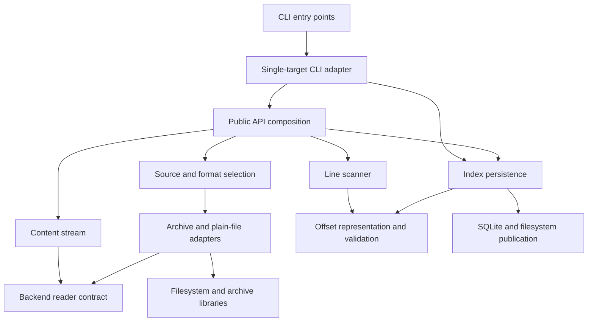

# Archive Line Index architecture

## Purpose and boundaries

[PROJECT](PROJECT.md) defines the intended scope. The system exposes a sequential payload stream, indexes any compatible binary stream and persists completed offset sequences. These capabilities have separate owners so archive handling cannot change line semantics and persistence cannot change scanning behavior.

## System structure

Arrows below mean that the originating block depends on the destination block. A readable stream is the boundary between content access and indexing; a completed offset sequence is the boundary between indexing and persistence.

| Block | Responsibility and boundary |
| --- | --- |
| Single-target CLI adapter | Parse one target and minimal output options, select the destination, invoke index construction and both persistence writers, and present status/errors. Console and module execution share an importable callable; importing the adapter has no side effects. Core components do not depend on CLI parsing or process state. |
| Public API composition | Expose the supported entry points and coordinate source-based index construction. It connects content opening to scanning without becoming a dependency of internal blocks. Standalone stream, scanner and persistence operations remain usable independently. |
| Source and format selection | Normalize filesystem paths, identify a format candidate from bounded inspection and suffix claims, and select a supported adapter. Complete archive validity remains the adapter's responsibility. |
| Content stream | Present the common read-only sequential interface; buffer bounded reads, count decompressed bytes, enforce the configured size limit and own adapter cleanup. It has no line or persistence semantics. |
| Archive and plain-file adapters | Open their own source resources, validate member structure, deliver original payload bytes and finish backend-specific integrity checks. They expose one internal reader/lifecycle contract despite different decompression mechanics. |
| Line scanner | Consume a caller-provided binary stream from its current position, detect LF boundaries and apply the initial UTF-8 BOM policy. It constructs offsets without assembling lines or importing archive adapters. |
| Offset representation and validation | Own the canonical `array("Q")` structure, EOF-sentinel interpretation and shared representable range. Scanning and persistence use this common definition rather than maintaining separate offset rules. |
| Index persistence | Validate complete arrays and independently encode/decode SQLite or raw little-endian files. A shared filesystem publication mechanism owns temporary sibling files, destination protection and replacement. Persistence does not open payload sources. |

A small shared error vocabulary supports consistent failures across these blocks. It depends on no higher-level operation. Public package initialization re-exports the supported surface; internal modules never import through that initialization layer. Backend-specific dependency objects do not escape through public interfaces.

The CLI depends downward on the index-building facade and SQLite/raw writers. Its two outputs are independent publications of one completed array; it does not add a cross-file transaction. It owns argument parsing, default destination naming and presentation; library operations retain explicit paths and Python exception semantics. Only executable entry-point wrappers terminate a process from the callable result.

## Content access and backend adaptation

The common content layer depends on a narrow internal readable interface with explicit completion and close behavior. Each adapter owns all file, archive and member handles it acquires. Detection uses a separate bounded inspection handle and releases it before adapter opening. This arrangement assumes a stable source during an operation; it does not create a filesystem snapshot or establish source identity.

| Source family | Delivery mechanism | Architectural consequence |
| --- | --- | --- |
| Plain file | Direct bounded reads | No decompression worker is needed. |
| ZIP | Pull reads through the standard-library member stream | Adapter validation covers member selection and integrity available through the library. |
| TAR and supported compressed-TAR variants | Sequential standard-library archive iteration and member reads | Structure discovered after payload delivery must still be checked before successful terminal completion. |
| 7z | `py7zr` callback output bridged to pull reads | A package-owned extraction thread publishes bounded byte blocks through a bounded queue, with cooperative cancellation and explicit terminal outcome. |

The 7z bridge is confined to its adapter. Queue capacity and block size bound package-controlled output buffering; neither bounds allocations inside the decompressor or archive metadata. Producer failure is conveyed to the consuming operation. Backpressure prevents unrestricted producer run-ahead, and cancellation must unblock package-controlled queue waits on both sides.

A thread avoids a process protocol, payload serialization and process-start requirements for library callers. A subprocess would provide a separate termination boundary but add those costs. The selected thread design requires the dependency to return to cancellation-observing code: close joins the worker and releases resources, but promises no fixed latency for an uninterruptible dependency or operating-system call. Dependency suitability and cancellation seams must be verified before this adapter is considered complete.

Format selection is explicit for the supported families. No public plugin discovery or general-purpose backend framework is needed. A backend addition should affect selection and its adapter without changing the scanner or persistence.

## Completion, ownership and failures

Payload delivery and validated completion are distinct. The adapter reports successful completion only after all integrity and trailing-structure checks available to it succeed. The content stream returns terminal EOF only after that success; a valid byte prefix does not certify the remaining archive.

Source-based index construction owns its content stream and closes it on success or failure. Direct scanning borrows its input and never closes it. The scanner returns a completed index only after successful stream exhaustion. Standalone stream consumers may stop early, in which case cleanup makes no integrity claim for unread content.

Argument checks precede resource acquisition where possible. Each block translates dependency failures at its boundary while retaining the original cause. A failure or cancellation cannot be represented as successful EOF. Cleanup must preserve the primary failure and report any additional cleanup failure without silently treating it as success.

## Offset data and persistence

Offsets address the original indexed byte space. BOM exclusion changes the first line start without changing that address space. The offset model owns line-start ordering, the final EOF sentinel and the range shared by unsigned in-memory storage and SQLite integers. Exact edge cases and public validation errors belong in SPEC.

Each persistence writer validates its input, constructs a complete representation in a uniquely named temporary sibling, completes format-specific checks and closes owned handles before publication. SQLite transaction handling belongs to the SQLite adapter; byte order conversion belongs to the raw adapter. Neither mutates the caller's offset array.

Publication distinguishes protected creation from authorized replacement. Protected creation must not silently replace a destination that appears concurrently; replacement uses an atomic same-filesystem operation where supported. An unavailable safe publication primitive is a surfaced filesystem limitation, not permission to publish a partial file or weaken protection. SPEC must define supported filesystem assumptions, publication failure semantics and cleanup after publication. There is no multi-file transaction, writer-locking service or universal power-loss durability guarantee.

Readers own their input handles and return a new validated complete array. They do not associate offsets with a payload source or verify source staleness.

## Resource model and verification seams

Package-controlled payload storage consists of stream buffers, the current scan block and bounded 7z transport blocks. The scanner never retains complete lines. The index occupies eight bytes per stored offset plus container overhead, and persistence loading intentionally materializes the index. Backend metadata and decompressor allocations are accounted for separately; explicit unbounded reads are caller-requested materialization.

The main verification seams are the internal backend reader, arbitrary short-read binary streams, producer outcome/cancellation transport, shared offset validation and filesystem publication. These allow tests to isolate chunk boundaries, late failures and resource release without making archive details part of scanner tests. Cross-format and installed-package tests verify the composed paths using actual dependencies and generated archives.

## Further design ownership

DECOMPOSITION defines concrete component collaboration, public/internal API surfaces, state ownership and selected model definitions. SPEC owns exact behavior, error contracts and acceptance, including format variants and dependency limits. PLAN and layout own delivery order and physical paths. These responsibilities do not require architecture child documents for the present scope.

## Progress observation

The scanner observes its existing original-byte position outside the LF-match loop. Per-scan monotonic state limits enabled INFO observations to five-second chunk-boundary intervals, with a final exact total after EOF/offset validation. Disabled logging performs no clock or record-formatting work. Observation adds neither a new data-flow component nor a source pass, payload buffer, dependency or worker; streaming-only consumers remain independent of indexing progress.

Named library loggers emit facts without configuring root/application logging. The CLI temporarily selects the emitting scanner logger's level, reuses effective application handlers or owns one temporary stderr handler, and restores its own changes. Configuration remains outside the domain algorithms and does not change error/resource/publication ownership. Library scans retain independent counters; applications serialize shared logging configuration and imported CLI invocations.
